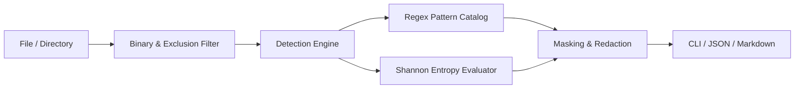

# Secret Sentry

Zero-exfiltration local secret scanner identifying exposed credentials, tokens, and high-entropy secrets.

[](https://github.com/AliSaleh07/secret-sentry/actions/workflows/ci.yml)

## Core Capabilities

- **Zero Exfiltration**: Runs strictly locally with zero external network connectivity or data transmission.
- **Shannon Entropy Analysis**: Flags pseudo-random high-entropy strings ($H(X) = -\sum P(x) \log_2 P(x)$) with threshold $H \ge 3.8$ bits.
- **Defensive Redaction**: Automatically masks sensitive credential values (`AKIA**************DEF`) in terminal output and reports.
- **Smart Filtering**: Skips binary assets, virtual environments, `.git` metadata, and oversized files (>10MB).



## Detection Catalog

| Rule | Target Type | Detection Method |
|---|---|---|
| `SEC-001` | AWS Access Key | `AKIA[0-9A-Z]{16}` pattern matching |
| `SEC-002` | GitHub Tokens | Personal access & OAuth token syntax |
| `SEC-003` | Slack Tokens | Workspace bot/user token formats |
| `SEC-004` | Private Keys | RSA, EC, DSA, OpenSSH PEM blocks |
| `SEC-005` | Stripe API Keys | Live secret & restricted key prefixes |
| `SEC-006` | Google Cloud API | GCP API key structure (`AIzaSy...`) |
| `SEC-007` | Database URIs | Embedded credentials in database strings |
| `SEC-008` | High-Entropy Strings | Token assignments with Shannon entropy $\ge 3.8$ |

## Quickstart

```bash
python -m venv .venv
source .venv/bin/activate
pip install -r requirements.txt
pip install -e .
```

## Usage

```bash
# Scan working directory
sentry scan .

# Pre-commit pipeline enforcement (fails on secrets)
sentry scan . --strict

# Generate JSON report
sentry scan . --format json -o secrets.json
```

## Running Tests

```bash
pytest -v tests/
```
---

## Safe Use & Privacy Disclaimer
*Secret Sentry is designed exclusively as a local-first, zero-exfiltration static analysis tool to prevent accidental credential leakage. It executes completely offline without transmitting data externally and must only be used on codebases and directories you have authorization to inspect.*
